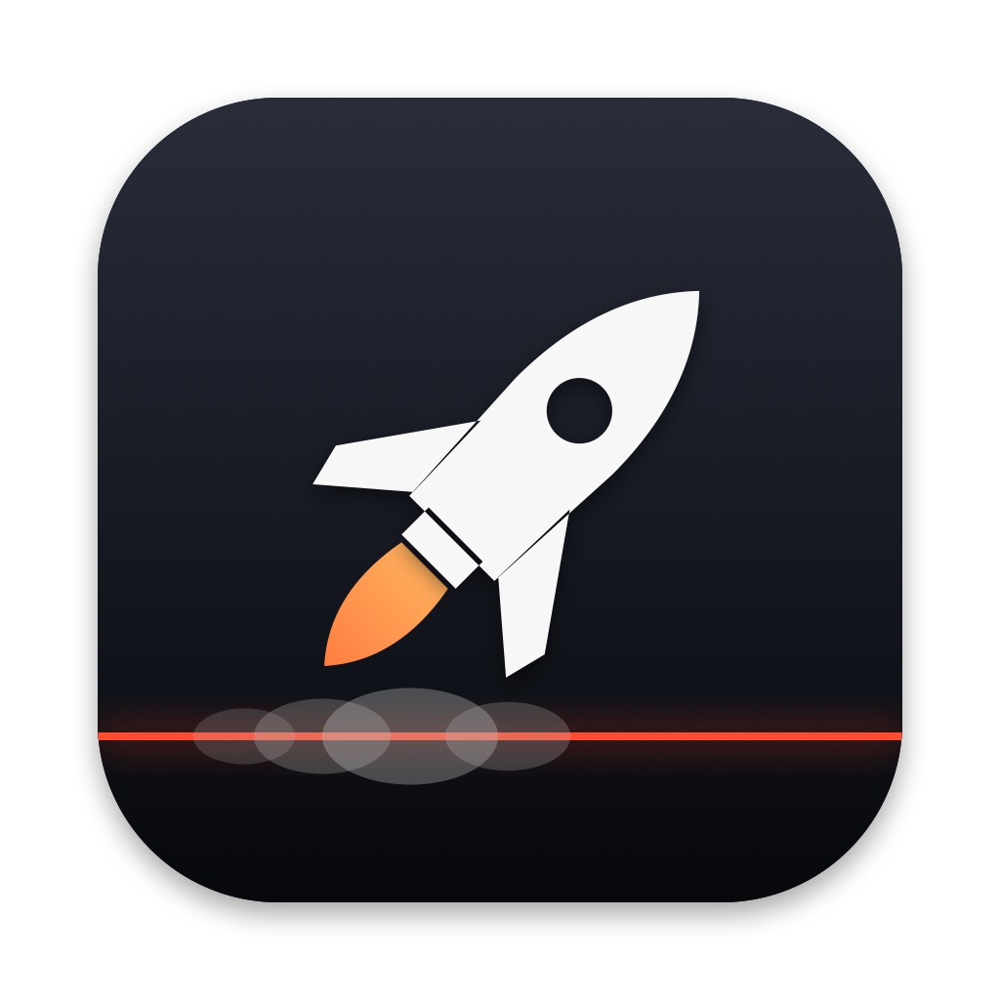
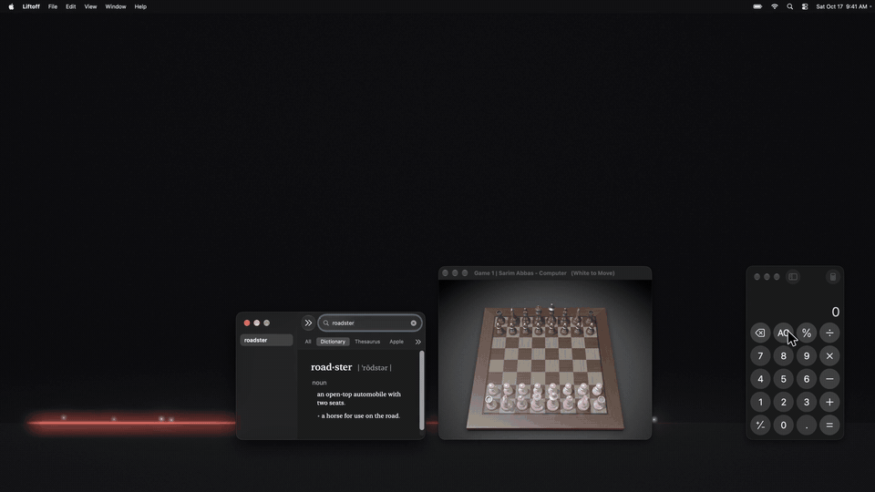

<p align="center">
  
</p>

<h1 align="center">Liftoff</h1>

<p align="center">Give your Mac's windows thrusters.</p>

<p align="center">
  
</p>

Hold a key and fling any window. It will fly with momentum and land wherever there's room.
Inspired by the Tesla Roadster.

## Install

```sh
brew install --cask campfireshuffle/tap/liftoff
```

Or grab the zip from [Releases](https://github.com/campfireshuffle/liftoff/releases). Needs macOS 14+
on Apple silicon.

## Use

Hold the modifier key of your choice, then grab a window and throw it across your screen.

## Permissions

Needs Accessibility and Screen Recording.

## Build

```sh
./scripts/package.sh && open dist/Liftoff.app
```

See [docs/releasing.md](docs/releasing.md) for signed releases.
